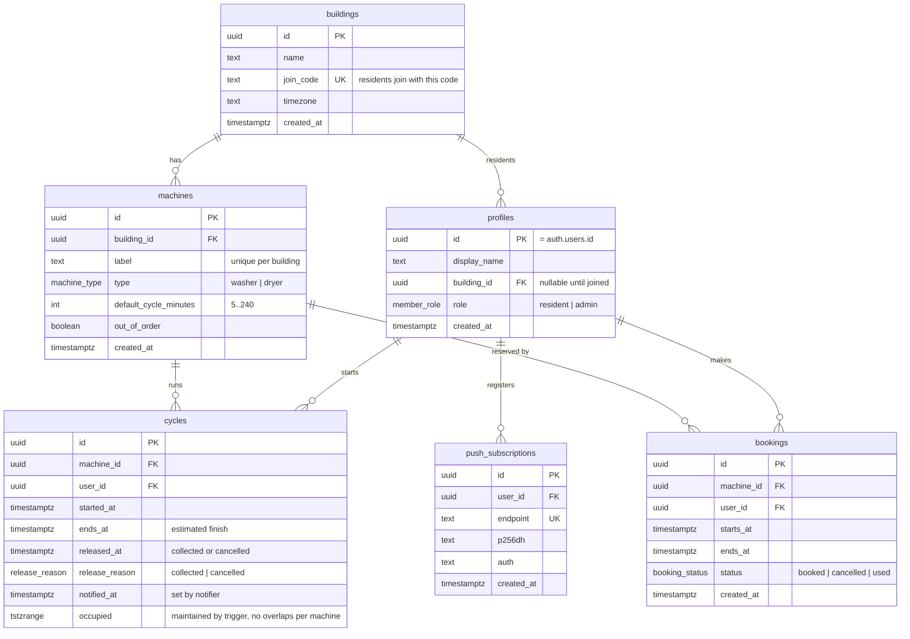

# WashSlot – Database Design

Owner: Database & QA. Status: **design (approved before implementation)**.
Stack: Supabase (Postgres 17, Auth, Realtime), consumed by the Next.js app via `@supabase/supabase-js`.

## 1. Requirements → data

| Core feature | What the database must provide |
| --- | --- |
| Live overview of machines with estimated finish time | `machine_status` view (free / in use / awaiting collection / reserved / out of order + `estimated_finish_at`), Realtime on `machines`, `cycles`, `bookings` |
| One-tap start + notification before the cycle ends | `start_cycle()` RPC, `cycles.ends_at`, `cycles.notified_at`, `push_subscriptions` |
| Book a machine for a time slot later in the day | `bookings` table, `create_booking()` / `cancel_booking()` RPCs, overlap protection |
| Success criterion: collect laundry ≤ 10 min after the cycle ends | `cycles.released_at` + `cycle_collection_stats` view |

## 2. Entity-relationship diagram

## 3. Machine state (derived, never stored)

State is computed in the `machine_status` view from `now()`, so no cron job is needed to "flip" machines.

| State | Rule (first match wins) |
| --- | --- |
| `out_of_order` | `machines.out_of_order = true` |
| `in_use` | a cycle with `now()` inside `occupied` and `now() < ends_at` |
| `awaiting_collection` | a cycle with `now()` inside `occupied` and `now() >= ends_at` |
| `reserved` | a `booked` booking with `now()` in `[starts_at, ends_at)` |
| `free` | otherwise |

`occupied = [started_at, least(released_at, ends_at + 15 min))`. The 15-minute grace period keeps
the machine marked for its owner after the cycle ends; afterwards it shows as free even if the owner
never taps "collected", so the overview can never get stuck.

## 4. Business rules (enforced in the database)

1. A machine can have only one occupying cycle at a time – `EXCLUDE USING gist (machine_id WITH =, occupied WITH &&)`.
2. A machine cannot have overlapping active bookings – `EXCLUDE ... WHERE (status = 'booked')`.
3. A cycle cannot start if it would overlap **another** resident's booking; starting during your **own** booking marks it `used`.
4. A booking cannot overlap a currently occupying cycle.
5. Bookings must start in the future and within 24 h ("later in the day"), and last 15 min – 4 h.
6. A resident can hold at most 2 upcoming bookings (fairness in a small building).
7. Out-of-order machines can't be started or booked.
8. Residents see only their own building's data (RLS). All writes to `cycles` and `bookings` go through RPCs; direct `insert/update/delete` is revoked from clients.

## 5. API surface for the frontend

| RPC | Purpose |
| --- | --- |
| `join_building(code text) → buildings` | Attach the current user to a building |
| `start_cycle(machine_id uuid, minutes int default null) → cycles` | One-tap start (`minutes` defaults to the machine's `default_cycle_minutes`) |
| `release_cycle(cycle_id uuid, reason release_reason default 'collected') → cycles` | Mark laundry collected / cancel |
| `create_booking(machine_id uuid, starts_at timestamptz, ends_at timestamptz) → bookings` | Book a slot |
| `cancel_booking(booking_id uuid) → bookings` | Cancel own booking |

Read access: `machine_status`, `machines`, `cycles`, `bookings`, `profiles` (same building), `cycle_collection_stats`.
Realtime: subscribe to `machines`, `cycles`, `bookings` and re-read `machine_status`.

## 6. Notifications (interface only)

The notification sender (owned by the backend team) selects cycles with `notified_at is null and ends_at - now() <= 5 min`
using the service role, sends the push to `push_subscriptions`, then sets `notified_at`. Index: `cycles_notify_idx`.

## 7. Out of scope / known limitations

- One building per user.
- Times are stored as `timestamptz` (UTC); the frontend formats using `buildings.timezone`.
- Building members can see who is using a machine (needed to resolve conflicts in a small building).
